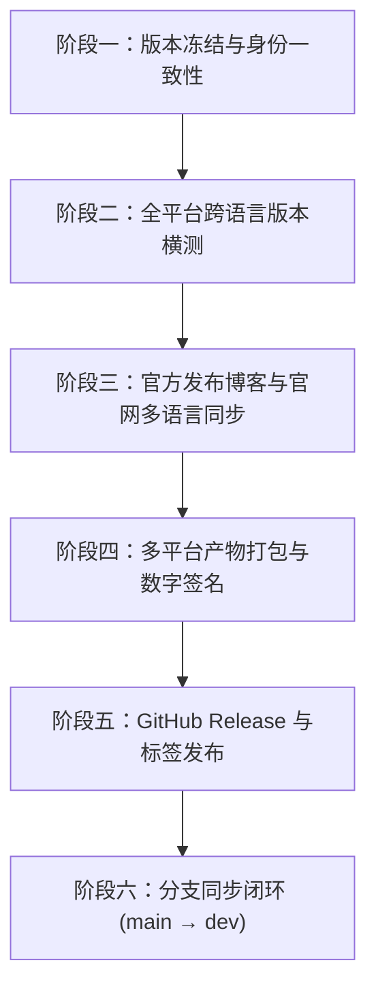

# Xu 官方发布标准流程与规范 (Release Process & Policy)

适用范围：`xulang-org` 名下所有仓库（特别是 `xu` 核心编译器仓库与 `xulang-org` 官网仓库）。  
本文是全生态正式发布（Official Release）的标准作业程序（SOP）。**所有正式版本的发布必须严格遵守本文规定的各阶段流程与核验项，严禁绕过任何发布门禁。**

---

## 1. 发布原则与权限纪律

1. **唯一版本源**：
   - Xu 编译器、标准库及 SDK 工具链的唯一版本源是 `xu/VERSION`。
   - 官网仓库 `xulang-org/VERSION` 及根 `xu.xun` 必须与所选定的 Xu 正式 SDK 完全对齐，严禁脱节。
2. **Minor/Major 变更授权**：
   - 第二个版本节点（Minor 版本，如 `0.13.x` → `0.14.0`）或首个节点（Major 版本），必须具备用户的明确发布授权，严禁自动化脚本或日常开发批次自行升级。
3. **正式发布的两个硬性前置要求（必须固定执行）**：
   - **版本横测（Cross-Language Benchmark Validation & Sync）**：正式版本发布前或紧随候选必须在全平台执行标准多语言基准横测，更新官网基准看板并记录可复现环境。
   - **官方发布博客与公告同步（Release Blog & Announcements）**：每个正式发布必须在官网发布中英文版本发布博客，并在多语言发行字典 `templates/releases.json` 中同步更新。

---

## 2. 发布标准全流程（6 个阶段）



### 阶段一：版本冻结与身份一致性

1. **版本清单对齐**：
   更新 `xu` 仓库内的全部清单与常量，确保它们与目标版本号（如 `0.14.0`）严格一致：
   - `xu/VERSION`
   - `xu/src/app/xu.xun` (`xu: !ver X.Y.Z`)
   - `xu/src/cmd/**/xu.xun`（所有子命令模块的 `version:` 与 `xu:` 字段）
   - `xu/src/cmd/desktop/pack_macos.xu` (`CFBundleShortVersionString` 与 `XuToolchainVersion`)
   - `xu/src/cmd/setup/main.xu` (`$req_version`)
   - `xu/src/xu/driver/driver.xu` (`compiler_version()`)
2. **编写结构化发布说明**：
   - 在 `xu/RELEASES.md`（英文）与 `xu/RELEASES.zh-CN.md`（中文）顶部追加新版本的完整说明。
   - 必须按模块分类：底层特性（裸机/内核/硬件契约）、编译器优化（GVN/PGO/SROA）、并发与调度、工具链与打包、破坏性变更与迁移指引。
3. **验证版本身份一致性**：
   执行版本自检脚本，确保清单、代码常量与编译器二进制一致无误：
   ```sh
   python3 scripts/check_release_identity.py --require-cli
   ```

---

### 阶段二：全平台跨语言版本横测（强制要求）

**规范要求：拒绝空泛的性能宣称。性能结论必须具备真实源码、测量环境、编译器提交和独立数据支撑。**

1. **独立横测仓库定位 (`xulang-org/bench`)**：
   - **独立维护原则**：Xu 的跨语言性能基准套件、工作负载源码（Osprey 24 题、Benchmarks Game、标准库、高并发网络等）及各语言对照实现（C Clang、Rust、Go、Swift）全部由独立的 **`xulang-org/bench`** 仓库独立维护，避免污染核心编译器源码。
   - **工具版本管理**：`bench` 仓库拥有独立的根 `VERSION` 标识工具集合版本，实际测试结果严格记录所测编译器版本、Git 提交哈希、平台硬件及运行时参数。
2. **测试矩阵与负载覆盖**：
   - **支持平台与架构**：双架构（`ARM64` + `x86_64`），覆盖三大主流操作系统（`Linux`、`macOS`、`Windows`），共计 6 大标准目标平台（`linux-arm64`、`linux-x64`、`macos-arm64`、`macos-x64`、`windows-arm64`、`windows-x64`）。
   - **对比语言工具链**：同环境下最新稳定版 C (Clang -O3)、Rust (rustc -O3)、Go (go build)、Swift (swiftc -O)。
   - **核心基准负载（72 组 Workloads）**：涵盖表达式树（expr_tree）、SPSC 通道会合延迟、高并发协程调度与内存开销、GEMM 矩阵乘法、SROA 聚合体拆解、JSON 解析、SHA-256 哈希计算等典型场景。
3. **在 `bench` 仓库触发自动化横测流水线**：
   - 正式版本发布时，在 `xulang-org/bench` 仓库触发自动化流水线（`.github/workflows/bench.yml`）：
     ```sh
     gh workflow run bench.yml --repo xulang-org/bench -f mode=full -f xu_ref=vX.Y.Z
     ```
   - 该工作流在 GitHub Actions 的 6 大标准 Runner 矩阵上完整拉取待测 Xu 编译器，全自动完成 72 项负载编译、对拍执行与可信度采样，生成 6 份结构化数据工件 `benchmark-reports-<target>`。
4. **数据导入与官网看板同步 (`xulang-org`)**：
   - 从 `bench` 的 Actions 运行产物中下载 6 平台的 `benchmark-reports-*` 工件包。
   - 在 `xulang-org` 仓库运行导入与校验脚本：
     ```sh
     # 检查工作负载目录与基准提交一致性
     python3 scripts/sync_all_benches.py
     # 导入 6 平台完整测量工件 (需指定版本、完整 commit 及 bench Actions run_id)
     python3 scripts/import-benchmarks.py --artifacts <path> --version X.Y.Z --commit <sha40> --run-id <id> --date YYYY-MM-DD
     # 重新生成全语言基准看板静态页面
     python3 scripts/gen-benchmarks.py
     ```
   - 验证 `www/benchmarks.json` 与 `www/bench_sources.json` 包含该版本的确切数据与源码映射，生成的 `content/{lang}/benchmarks.html` 包含最新实测图表，并将关键横测数据写入发布说明与发布博客中。

---

### 阶段三：官方发布博客与官网多语言同步（强制要求）

**规范要求：每一个正式版本必须在官方网站同步上线对应的版本发布博客与多语言元数据，确保用户与社区清晰获知演进细节与迁移指引。**

1. **撰写中英文官方发布博客**：
   在 `xulang-org` 仓库中新增：
   - `content/zh/blog/xu-X-Y-Z.html`（中文版）
   - `content/en/blog/xu-X-Y-Z.html`（英文版）
   
   **博客结构规范**：
   - **头部元数据**：`<!--title: ...-->` 与 `<!--summary: ...-->`，面包屑导航 `<p class="crumb">`，主标题 `<h1>`，发布日期与 GitHub Tag 链接 `<p class="meta">`。
   - **版本综述**：版本定位、重大里程碑意义、架构演进概述。
   - **核心技术深度剖析**：分章节详细解析 3~5 项核心新特性（如裸机支持、内联汇编、新优化 Pass 等），配有真实语法示例代码与底层设计权衡。
   - **版本横测实测数据表**：直接嵌入阶段二测得的横向基准表格，对比 Go、Rust、C 等主流语言的实测耗时、吞吐量或内存占用。
   - **破坏性变更与迁移指南**：若有语法、ABI 或行为变动，提供明确的升级替换方案。
   - **分发与致谢**：指引官方二进制包下载中心、SHA-256 校验和、文档手册与源码仓库。

2. **多语言发行字典同步 (`templates/releases.json`)**：
   在 `xulang-org/templates/releases.json` 数组首部插入新版本条目：
   - `version`: `"X.Y.Z"`
   - `blog_entry`: 包含全部 10 种支持语言（`en`, `zh`, `zh-tw`, `ja`, `ko`, `es`, `fr`, `de`, `ru`, `pt-br`）的博客超链接与简述（例如 `<a href="/blog/xu-X-Y-Z">...</a> · YYYY-MM-DD`）。
   - `notes`: 包含全部 10 种语言的版本精简摘要及 SHA-256 校验链接。

3. **官网版本清单与构建校验**：
   - 更新 `xulang-org/VERSION` 为 `X.Y.Z`。
   - 更新 `xulang-org/xu.xun` 的 `version:` 与 `xu:` 为 `!ver X.Y.Z`。
   - 执行静态站点完整构建：
     ```sh
     python3 scripts/build-static.py
     ```
   - 验证：确保 996+ 个静态 HTML 页面构建零报错、所有内部链接解析正常、演练场与 WASM 模块版本校验通过。

---

### 阶段四：多平台产物打包与数字签名

1. **多平台 SDK 打包**：
   - 包含 Linux (x64 / arm64 / riscv64 / loongarch64)、macOS (Apple Silicon / Intel)、Windows (x64 / arm64) 的原生与交叉构建安装包。
   - 包含 DevKit 与独立二进制分发。
2. **macOS 代码签名**：
   - 针对 macOS arm64/x64 分发二进制及 Setup 安装程序，必须执行有效的 Ad-hoc 或开发者身份签名（`codesign --force --deep --sign -`），防止 Gatekeeper 拦截或杀死进程。
3. **SHA-256 校验清单生成**：
   - 对全部打包工件计算 SHA-256 散列并汇编为 `SHA256SUMS` 文件，随 Release 附件一同提供。

---

### 阶段五：GitHub Release 与标签发布

1. **创建正式 Git 标签**：
   - 标签命名遵循 `vX.Y.Z`（无预发布后缀）。
   - 必须基于经过严格测试验收的 `main`（或待发布的 `dev`）提交创建。
2. **创建 GitHub Release**：
   - Release 标题为 `Xu X.Y.Z`。
   - 正文填入 `RELEASES.md` 对应的英文内容，并附带官网博客链接与中文发行说明链接。
   - 上传全平台打包产物及 `SHA256SUMS`。
   - 确保非草稿（Draft: false）且非预发布（Prerelease: false）。

---

### 阶段六：分支同步闭环

1. **合并回 `dev` 分支**：
   - 生产发布合入 `main` 后，使用带有完整历史的 Merge commit 将 `main` 的发布变更合并回 `dev` 分支。
   - 严禁对长期分支采用 Squash 导致历史断裂。
2. **开启下一开发周期**：
   - 在 `dev` 分支将 `VERSION` 递增为下一开发版本（如 `0.14.1-dev.1` 或 `0.15.0-dev.1`）。
   - 重新运行 `scripts/check_release_identity.py` 确保开发周期正常推进。

---

## 3. 发布前强制检查清单 (Release Checklist)

发布负责人在批准和触发发布前，必须逐项核对以下清单：

- [ ] **[授权]** 本次发布的目标版本号明确；若为 Minor/Major 升级，已取得用户/负责人的明确批准。
- [ ] **[版本一致性]** `xu/VERSION`、所有 `xu.xun`、`driver.xu`、`setup/main.xu` 与 `pack_macos.xu` 均已更新且完全一致。
- [ ] **[发行说明]** `xu/RELEASES.md` 与 `xu/RELEASES.zh-CN.md` 已完整记录新版本变更、优化、特性与破坏性说明。
- [ ] **[身份检查]** `python scripts/check_release_identity.py --require-cli` 运行结果为 `PASS`。
- [ ] **[版本横测]** 6 大主流目标平台（ARM64/x64）横测数据已完整采纳，`www/benchmarks.json` 已校验，`gen-benchmarks.py` 成功生成多语言基准页面。
- [ ] **[发布博客]** 官网 `content/en/blog/xu-X-Y-Z.html` 与 `content/zh/blog/xu-X-Y-Z.html` 已撰写完毕，包含深度技术剖析与基准对比数据。
- [ ] **[多语言发布项]** `templates/releases.json` 中 10 种语言的 `blog_entry` 与 `notes` 均已准确配置并校验。
- [ ] **[官网构建]** `python scripts/build-static.py` 执行成功，全量页面构建零失效链接。
- [ ] **[工件与签名]** 二进制产物已生成，macOS 二进制与安装器已完成签名，`SHA256SUMS` 校验清单完备。
- [ ] **[分支闭环]** 发布完成后已规划 `main` 到 `dev` 的合并回补与下一开发版本的版本推进。
